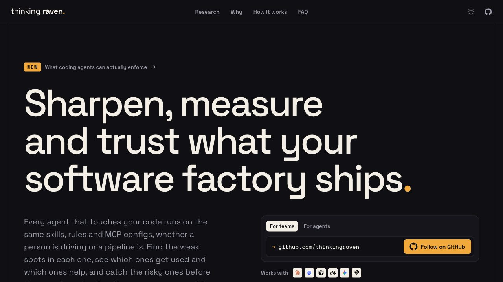
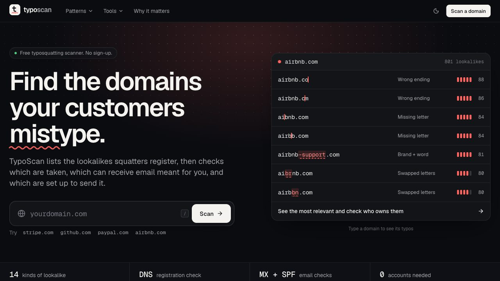
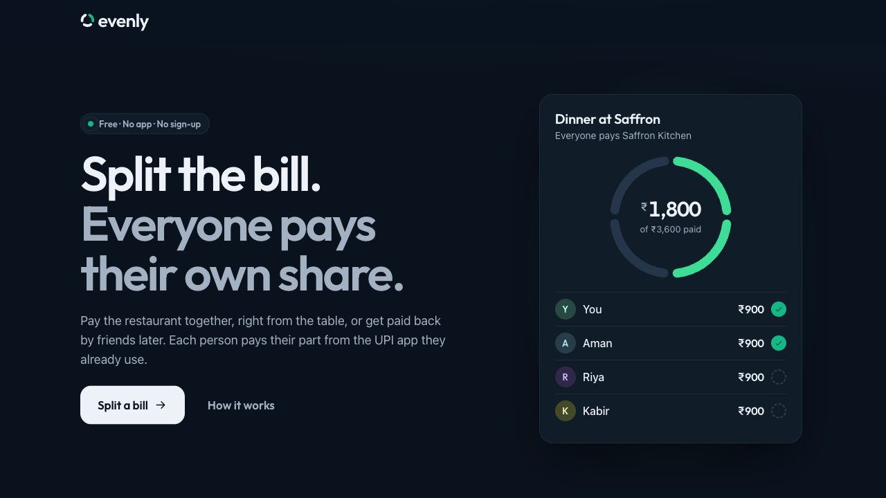
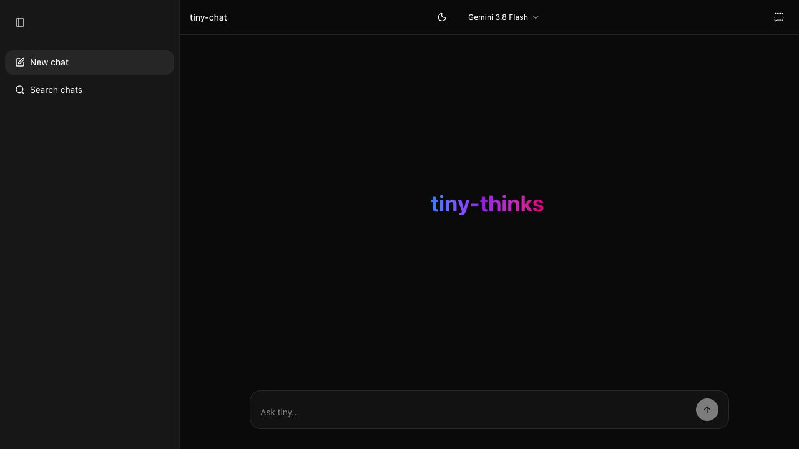

<picture>
  <source media="(prefers-color-scheme: dark)" srcset="assets/banner-dark.png">
  
</picture>

I build open-source tools for teams working with AI agents at [Thinking Raven](https://thinkingraven.com), and small web apps that do one job well.

<table>
  <tr>
    <td width="50%" valign="top">
      
       <b><a href="https://thinkingraven.com">Thinking Raven</a></b>
       Sharpen, measure and trust what your software factory ships.
       <a href="https://github.com/thinkingraven/rookery">rookery</a> · <a href="https://github.com/thinkingraven/roost">roost</a>
    </td>
    <td width="50%" valign="top">
      
       <b><a href="https://www.typoscan.in">typoscan.in</a></b>
       Find the lookalike domains your customers might mistype, and check which ones are taken.
    </td>
  </tr>
  <tr>
    <td width="50%" valign="top">
      
       <b><a href="https://tryevenly.com">tryevenly.com</a></b>
       Split a bill and everyone pays their own share by UPI. No app, no sign-up.
    </td>
    <td width="50%" valign="top">
      
       <b><a href="https://tiny-chat-five.vercel.app">tiny-chat</a></b>
       A local-first Gemini chat. Your history never leaves the browser.
       <a href="https://github.com/iBvishal/tiny-chat">Code</a>
    </td>
  </tr>
</table>

#### Open source

- [**rookery**](https://github.com/thinkingraven/rookery): find every agent skill in your repos, spot the duplicates and catch the risky ones. `npx @thinkingraven/rookery scan .`
- [**roost**](https://github.com/thinkingraven/roost): see which skills, subagents and MCP servers your agents actually use. `npx @thinkingraven/roost usage`
- [**tiny-chat**](https://github.com/iBvishal/tiny-chat): local-first Gemini chat with IndexedDB history and bring-your-own-key.

TypeScript · Next.js · React · Node · Python · [LinkedIn](https://www.linkedin.com/in/vishal-bhardwaj-b72702114/)
