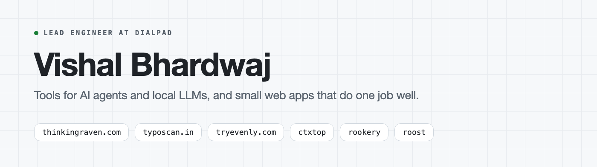

<picture>
  <source media="(prefers-color-scheme: dark)" srcset="assets/banner-dark.png">
  
</picture>

Lead Engineer at [Dialpad](https://www.dialpad.com) (work account: [@vishaldialpad](https://github.com/vishaldialpad)). In my free time I build open-source tools for AI agents and local LLMs, and small web apps that do one job well.

#### Open-source tools

**For local LLMs**

- [**ctxtop**](https://github.com/iBvishal/ctxtop): `top` for local LLMs. Live speed, context fill and memory for every model in llama.cpp, Ollama and LM Studio, and what to change when something's off. `brew install --cask iBvishal/tap/ctxtop`

**For AI agents**, at [Thinking Raven](https://thinkingraven.com): sharpen, measure and trust what your software factory ships.

- [**rookery**](https://github.com/thinkingraven/rookery) · [npm](https://www.npmjs.com/package/@thinkingraven/rookery): find every agent skill in your repos, spot the duplicates and catch the risky ones. `npx @thinkingraven/rookery scan .`
- [**roost**](https://github.com/thinkingraven/roost) · [npm](https://www.npmjs.com/package/@thinkingraven/roost): see which skills, subagents and MCP servers your agents actually use. `npx @thinkingraven/roost usage`

#### Web apps

- [**typoscan.in**](https://www.typoscan.in): find the lookalike domains your customers might mistype, and check which ones are taken.
- [**tryevenly.com**](https://tryevenly.com): split a bill and everyone pays their own share by UPI. No app, no sign-up.
- [**tiny-chat**](https://tiny-chat-five.vercel.app): a local-first Gemini chat. Your history never leaves the browser. ([code](https://github.com/iBvishal/tiny-chat))

Go · TypeScript · Next.js · React · Node · Python · [LinkedIn](https://www.linkedin.com/in/vishal-bhardwaj-b72702114/)
